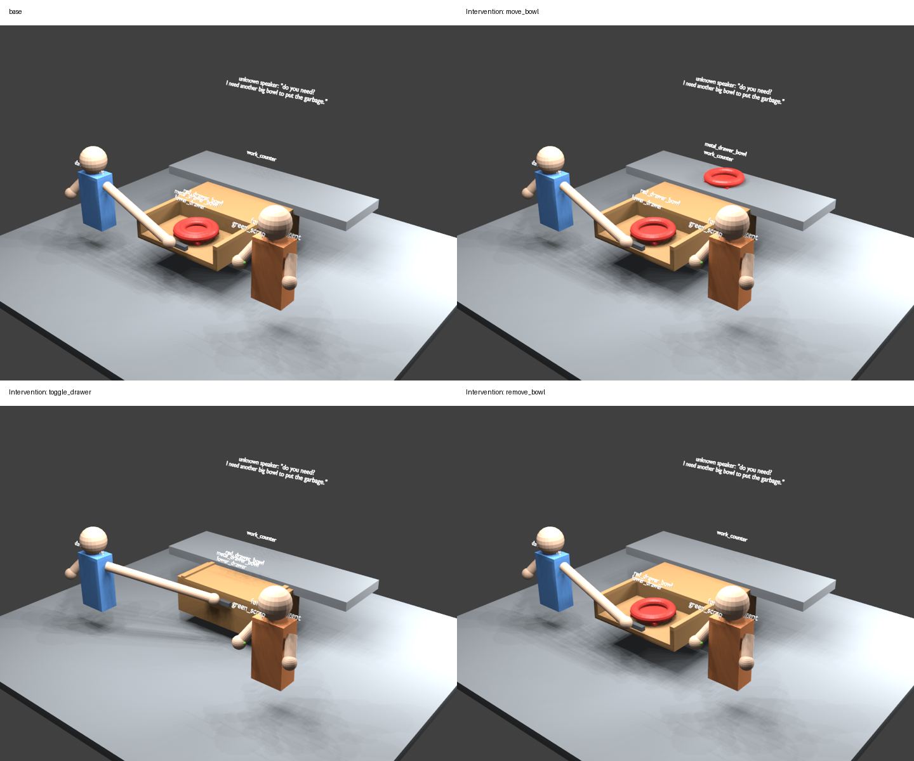

# GPT-6 → 可编辑代理世界 / Editable proxy-world demo

**2026-09-16 · 已保存的真实模型输出 · 可下载 Blender 场景 · 无 API 离线重放**

> 这是一个预选开发案例的代码→可编辑代理世界工程演示，**不是高保真图像重建、物理仿真证明或问答 benchmark 增益**。几何检查通过只说明生成的代理满足已实现的关系约束，不说明模型识别的内容与原视频完全一致。



## 看结果 / 下载可编辑文件

| 场景 | 图片 | 可编辑 Blender 文件 | World 代码 |
|---|---|---|---|
| 基础场景 | [预览](rendered/base/render.png) | [scene.blend](rendered/base/scene.blend) | [代码](cases/base/world_code.py) |
| 把内层金属碗移到台面 | [预览](rendered/intervention_move_bowl/render.png) | [scene.blend](rendered/intervention_move_bowl/scene.blend) | [代码](cases/intervention_move_bowl/world_code.py) |
| 关闭原本打开的抽屉 | [预览](rendered/intervention_toggle_drawer/render.png) | [scene.blend](rendered/intervention_toggle_drawer/scene.blend) | [代码](cases/intervention_toggle_drawer/world_code.py) |
| 删除内层金属碗 | [预览](rendered/intervention_remove_bowl/render.png) | [scene.blend](rendered/intervention_remove_bowl/scene.blend) | [代码](cases/intervention_remove_bowl/world_code.py) |
| 相同 seed 重复生成基础场景 | [预览](rendered/base_repeat/render.png) | [scene.blend](rendered/base_repeat/scene.blend) | 与基础场景相同 |

点击 `.blend` 页面上的 **Download raw file** 下载，用 Blender 打开即可编辑物体、材质和相机；在 Scripting 工作区可查看嵌入的 World 代码、场景 JSON 和生成记录。这些声明式 `W.*` 代码由随包的受限 DSL 执行器解析，不是直接 `python world_code.py` 执行。

## 实际验证了什么

- 基础模型输出编译为 **18 条 World 语句、7 个实体**。
- 基础场景与三个编辑场景全部通过生成、几何和非空预览检查。
- 三项编辑均通过语义单因素检查、预期几何变化及主物体几何局部性检查。关闭抽屉允许抽屉内碗一起移动。
- seed=17 的基础场景重复生成：**几何快照字节相同**；这不承诺跨 Blender/GPU 版本的图片或 `.blend` 文件字节相同。
- 详细记录：[summary.json](analysis/summary.json)、[results.csv](analysis/results.csv)、[语句/证据对应表](analysis/evidence_trace.csv)。每个 `rendered/` 子目录还有独立几何检查、生成记录和几何快照。

## 模型来源与修复历史

输入为 CoMind/SCOIA `032159` 的六帧与短转录，属于**此前已查看的开发展示案例，不是随机盲测样本**。[输入清单](inputs/input_manifest.json)保存帧顺序、时间和 SHA-256；原图已在本仓库 [reports/cases](../../reports/cases/) 中，不在此重复打包。

1. 本次原始 Spatial/Social **两次新 API 调用**请求 `gt-6-as-a`，服务端均报告 `gpt-6-astra`。
2. 模型返回的原始结构化代码：[Spatial](inputs/spatial.json)、[Social](inputs/social.json)。两者按原字节保存；[编译后的 World 代码](compiled/world_code.py)由程序确定性生成，不是额外一次模型调用。
3. 初次生成有 containment 检查失败：默认内层碗尺寸及偏移不能放进外层碗，见[保留的失败检查](history/original_failed_geometry_checks.json)，失败项 `W09`。
4. 修复通用代理布局：必要时等比缩小被包含物、限制位置偏移；**没有扩大容器或放宽几何检查阈值**。这是程序化代理几何修复，不是从原图恢复尺寸。
5. 此处发布的是修复后 `run_20260916_gpt6_demo_replay_v3` 的成果，重放同一份输出，**新增模型调用为 0**，没有重新抽样挑结果。

[provenance.json](provenance.json)记录两次调用的实际模型、usage、原始 API 响应哈希、模型输出哈希和冻结源码哈希。API 元数据是本地记录的白名单提取，不是独立第三方认证。未发布密钥、完整 API 信封、请求体、后台日志或其他评测数据。

## 离线核验与重放（不需要模型密钥）

成果包自带最小冻结源码，不依赖仓库中尚未提交的本地修改。

```bash
# 在仓库根目录执行；只核验文件哈希、模型编译与已记录结果，无需 Blender
python demos/gpt6_editable_world_20260916/replay.py --verify-only

# 完整重放：安装 Pillow；系统需 Blender 和 Xvfb（有显示环境可用 --no-xvfb）
python -m pip install Pillow
python demos/gpt6_editable_world_20260916/replay.py \
  --output /tmp/gpt6_world_replay_new
```

输出目录必须不存在，脚本不覆盖历史记录。脚本重新编译核对原始模型代码、重新生成三个编辑、渲染五个场景，再执行独立几何和局部性分析；**不会发起 API 请求**。返回结果同时记录新几何快照是否与发布版本一致。原运行使用 Python 3.9、Blender 3.0.1、Pillow、Xvfb；不同渲染环境可能影响像素结果。

如需改代码探索新场景，应在成果包外复制源码/场景；发布包的 SHA-256 核验会拒绝被修改的文件，避免把新编辑混称原实验。`source/experiments/astra_world_demo_v1/` 下提供编译器、编辑生成器、Blender 生成器和检查器，可作为进一步编辑入口。

冻结源码的单元测试：

```bash
cd demos/gpt6_editable_world_20260916/source
PYTHONPATH=. python -m pytest -q tests/test_proxy_geometry.py tests/test_astra_world_demo_v1.py
```

测试夹具仅用于单元测试；此处的模型结果没有用人工夹具替换。

上传前已实际执行以上离线重放：五个场景检查全部通过，五份几何快照均与发布版本相同；冻结源码 **9 项单元测试通过**。见 [publication_validation.json](publication_validation.json)。这次上传验证同样没有调用模型。

## 尚未解决的边界

[reconstruction_readiness.json](reconstruction_readiness.json)仍标记 **not_ready_for_reconstruction_benchmark**：柜体装配未显式建模、相机未对齐原图、人体使用默认代理、碗几何没有图像拟合；没有独立真实 3D 标注。三个编辑是合成反事实，不能当作原视频中发生的事实。

为保持原始哈希，成果 JSON 和 `.blend` 内保留了历史机器上的来源路径；这些路径只是审计元数据，不是离线重放所需的依赖。公开重放脚本只使用本目录中的相对路径。
