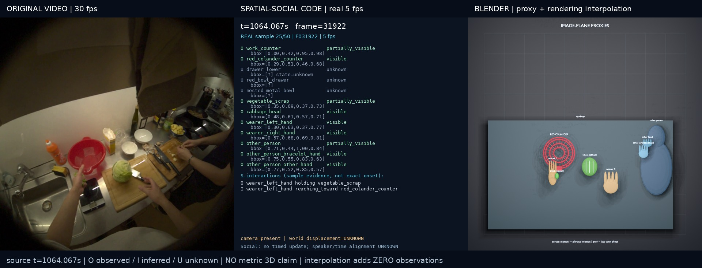

# CoMind 032159 · Temporal Spatial–Social Code + Blender

[](comparison_preview.mp4?raw=true)

**[Download synchronized comparison video](comparison_preview.mp4?raw=true)** ·
**[Download editable Blender scene](blender/temporal_scene.blend?raw=true)** ·
[中文详细报告](REPORT_ZH.md)

This is an **offline retrospective annotation and editable 2.5D image-plane
proxy animation**, not metric 3D reconstruction, an online causal tracker,
or evidence of benchmark improvement. Image motion includes camera motion;
the fixed Blender display camera is not a recovered physical camera.

## Evidence and outputs

- Requested original interval: **1059.067–1069.067 s**, CoMind **032159**.
  Nearest source timestamps: **1059.066667–1069.066667 s**.
- **51 real observations at 5 fps**, including both endpoints: zero-based
  source frames **31772–32072, stride 6**, from the original 30 fps recording.
  These are not interpolations of six images. Original PNGs are retained at
  1408 × 1408; model inputs are derived 704 × 704 JPEGs.
- Six fresh model calls: request `gt-6-as-a`, response `gpt-6-astra`.
  Adjacent-frame context and first/last identity anchors were available.
  Publication uses the saved output; **no publication-time model resampling**.
- **12 persistent task-relevant IDs**, explicitly separating the countertop
  red colander, red drawer bowl and nested metallic bowl.
- Per-observation visibility, estimated image boxes, relations, interactions
  and state changes distinguish `observed`, `inferred`, and `unknown`.
  Model boxes are not independent ground truth. Occlusion does not delete IDs.
- **0 timed Social Code updates**: transcript speaker and timestamp remain
  null; no invented identity, belief change or conversation sequence.
- **301 render frames at 30 fps** are saved separately from observations.
  Coordinates are arbitrary-unit proxies, not metric positions. Missing
  boxes are not interpolated; grey last-seen ghosts do not claim a current
  hidden position.

| Artifact | Link |
| --- | --- |
| Temporal Code (data / readable executable Python) | [JSON](temporal_code.json) / [Python](temporal_code.py) |
| Original frames and timestamp/hash manifest | [51 PNGs](frames/) / [manifest](observations_manifest.json) |
| Model input copies / annotated evidence | [JPEGs](model_frames/) / [overlays](annotated_observations/) |
| Evidence lookup / stable IDs | [index](evidence_index.json) / [registry](entity_registry.json) |
| Observation tracks / render-only interpolation | [tracks](blender_animation_tracks.json) / [interpolation](render_interpolation.json) |
| Original 30 fps clip / Blender video | [clip](original_clip.mp4?raw=true) / [animation](blender_animation.mp4?raw=true) |
| Raw structured responses, prompts, metadata | [six batches](model_calls/) |
| Conservative compiler corrections | [17 corrections](audit_corrections.json) |
| Validation / publication provenance | [validation](final_validation.json) / [provenance](publication_provenance.json) |

## Important uncertainty

The complete colander put-down, stable support and final left-hand release
are **not established**. Vegetable-remnant separation/continuity, hidden
hand contact, hidden drawer state, physical camera trajectory, metric depth,
and exact transition times cannot be reliably recovered. Drawer samples
support closed → partially open → open near the end, but transition times
are intervals, not invented exact instants. See the Chinese report for details.

## Watch locally

GitHub does not execute `index.html`. Clone/download the repository, then:

```bash
cd demos/gpt6_temporal_comind032159_20260916
python3 -m http.server 8000 --bind 127.0.0.1
```

Open `http://127.0.0.1:8000/` for synchronized video controls, or download
the comparison MP4 above for a single three-panel playback.

## Verify and replay without API calls

Python 3.9+; integrity verification uses only the standard library:

```bash
python3 replay.py --verify-only
```

To regenerate the editable scene and 301 Blender PNGs into a **new** directory
(requires Blender 3.x, tested with the original EEVEE implementation; on
headless Linux also install Xvfb):

```bash
python3 replay.py --output /tmp/comind032159-replay
```

This checks the regenerated saved scene against exported tracks; it does not
call GPT, re-estimate observations, or recreate the comparison MP4. The saved
scene can also be opened directly in Blender to inspect keyframes and embedded
Code. Internal consistency checks do not validate reconstruction accuracy.

### Frozen source and repair history

Use **`source_v3/blender_temporal.py`** for the corrected renderer; other pipeline
steps are frozen in `source_v2/`. `source/` and hash manifests preserve earlier
provenance, not the recommended renderer. The drawer-state custom property was
originally integer-valued and rounded `0.5` to `1`; it was mechanically repaired
to float. No model outputs, geometry, positions, scales or visibility channels
were changed. The original failed scene and repair record are in [history/](history/).

Original artifact bytes, including historical local paths in provenance, are
preserved. Those paths are records, not prerequisites for offline replay.
Full API envelopes, transport logs, credentials, the full recording and
intermediate render PNGs are excluded; structured model payloads are included.
`SHA256SUMS.json` covers this publication bundle (except itself).

Source video and frames originate from CoMind; this bundle does not grant new
rights to third-party source material. No paper text is changed by this release.
