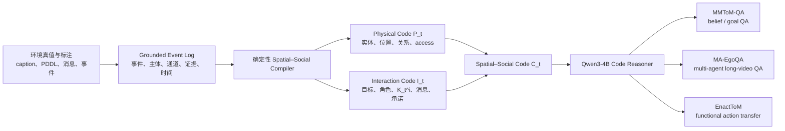

# Spatial–Social Code：模型训练与首批 Benchmark 方案

更新日期：2026-08-03

## 1. 当前决策

本项目可以进一步收敛为一个与 **Thinking with Spatial Code** 高度平行、但面向多主体社会理解的问题：

> 将多主体视频或事件流编译成显式的 Spatial–Social Code，再训练一个小型语言模型稳定读取代码，完成目标、信念、视角、协作和反事实推理。

首批只选择两个以“理解”为主、且当前可以启动的环境：

1. **MMToM-QA**：受控家庭环境中的目标与信念理解，适合验证代码本身和训练 code reasoner；
2. **MA-EgoQA**：真实、长时、多主体第一视角理解，适合验证方法能否扩展到复杂真实场景。

**EnactToM 暂不作为第一训练环境**，而作为第二阶段从 QA 理解迁移到 functional action 的外部验证。HoloAssist、CoMind 和 EgoTaskQA 暂时保留为后续扩展。

模型选择上，方法主线只使用 **Qwen3-4B**：它读取 Spatial–Social Code，经过 SFT/RL 学会基于显式物理—社会变量完成理解和推理。

**Qwen3-VL 不进入我们的方法 pipeline。** 如果让一个通用 VLM 同时看视频、生成隐式表示并回答问题，就会重新回到端到端 VLM 路线，无法证明显式 code 是否必要。论文中可以引用 Qwen3-VL 的公开结果，或把它作为外部 direct-video baseline，但不把它作为 compiler、teacher 或主模型。

Spatial Code 原论文的结构也是“专用 Spatial Encoder 生成显式 code，再由 Qwen3-4B 推理”，不是用 Qwen3-VL 代替 code。我们的第一阶段更简单：先用环境真值、标注和确定性 reducer 得到 oracle/semi-oracle Spatial–Social Code，只训练 Qwen3-4B 理解 code。

## 2. 与 Spatial Code 的对应关系

Thinking with Spatial Code 将视频推理拆成：

`RGB video → Spatial Encoder → explicit 3D Spatial Code → Qwen3-4B → answer`

我们的对应版本是：

`multi-agent observations → Social-Spatial Compiler → Spatial–Social Code → Qwen3-4B → answer/action`

两者的共同假设是：

> 模型看到输入，不等于模型内部拥有适合推理的变量；显式、可训练、可审计的中间表示可能比扩大模型规模更重要。

两者的变量对应如下：

| Spatial Code | Spatial–Social Code | 含义 |
|---|---|---|
| object identity | persistent entity / agent identity | 跨时间保持身份 |
| 3D position、size、orientation | location、holding、inside、near、access | 物理状态与可达性 |
| temporal tracking | grounded event log | 时间连续性与状态更新 |
| viewer-relative geometry | agent-relative observation/access | 主体视角差异 |
| GT vs predicted spatial code | oracle vs predicted social code | 分离编译误差与推理误差 |
| spatial rubric reward | social-state rubric reward | 用可验证规则训练推理 |

Spatial–Social Code 定义为：

`C_t = (P_t, I_t)`

其中：

- `P_t`：实体、物理属性、空间关系、主体可接入关系；
- `I_t`：目标、角色、agent-indexed 信息状态、消息与承诺、近期交互事件。

它不仅回答 “Where is everything?”，还回答：

- 谁观察或收到了什么；
- 谁没有可验证的信息接入；
- 每个主体当前的目标和角色是什么；
- 谁应该做什么或发送什么消息；
- 删除消息或改变角色后，哪些结论应该变化。

## 3. 建议的总体 Pipeline



这个 pipeline 中有两个不同的学习问题，实验时不能混在一起：

1. **Code understanding**：给定 oracle/semi-oracle code，Qwen3-4B 能否正确推理？
2. **Code compilation**：环境标注和 reducer 能否稳定、query-independent 地生成正确 code？

第一篇工作的核心放在第 1 个问题，第二个问题先用确定性 adapter/reducer 解决。只有 oracle code 确实带来增益，未来才单独研究从原始视频预测 code 的专用感知模块；该模块也不应取代 code。

## 4. 环境、已发表方法与选择

以下“最好结果”以截至 2026-08-03 可核对的论文或官方仓库为准；不同输入模态和协议的数字不能直接横向比较。

| 环境 | 当前代表性最好方法/结果 | 与本项目关系 | 决策 |
|---|---|---|---|
| **MMToM-QA** | 官方 multimodal：AutoToM + Model Specification 79.8%；官方 text-only：Muse-Spark-1.1 88.7%；PDDL-Mind 在独立 text/state 协议报告 88.3% | 目标、信念和逆向规划；显式状态路线与我们高度相关 | **首批选择** |
| **MA-EgoQA** | EgoMAS + Gemini-2.5-Flash：41.41%；EgoMAS + Qwen3-VL-8B-Thinking：40.26%；Gemini oracle：83.80% | 真实多主体、长视频、信息聚合和视角边界 | **首批选择** |
| **EnactToM** | hard split 上七个 frontier models 的 functional Pass^3 均为 0；最好 hard Avg 仍只有个位数 | 最强 functional ToM 验证，但首先是行动与仿真任务 | 第二阶段 transfer |
| HoloAssist | action recognition、anticipation、mistake/intervention 等多个子任务，没有单一 QA 总分 | 适合 coordination 与 predicted compiler | 后续 |
| CoMind | joint attention、handover、SCOIA 等多项社会交互标注，目前不是统一 QA leaderboard | 适合真实双主体社会感知 | 后续补充 |
| EgoTaskQA | 任务状态、因果、预测与反事实 QA；本地数据仍受许可限制 | 与 physical-social task understanding 相关 | 取得许可后再评估 |

### 4.1 为什么首选 MMToM-QA

MMToM-QA 有 600 道正式测试问题，覆盖 belief inference 与 goal inference。官方文本和问题文件约 1.1 MB；完整视频约 257 GB。官方另外提供 1,000 条带 scene、object、goal 和 belief 真值的程序生成行为数据，但刻意不提供训练 QA。

还需要关注 2026 年预印本 **PDDL-Mind**：它把 MMToM-QA 的动作动词恢复成可执行 predicate transitions，在 text-only verified states 条件下用 GPT-4o 报告 88.3% accuracy、用 Claude-Sonnet-4.5 报告 90.9%。这不是官方 multimodal leaderboard 协议，也尚未成为稳定的正式社区榜结果，但它与我们的 executable code 路线非常接近；正式实验必须单列其输入条件、模型 backbone 与评测协议。

它适合我们的原因是：

- 世界状态受控，容易得到 oracle Spatial–Social Code；
- 目标、信念、观察和动作之间关系明确；
- BIP-ALM、AutoToM 和 PDDL-Mind 都使用显式模型、逆向规划或 verified state tracking，是必须正面对比的强结构化基线；
- 可以先做 text/state-only，不必立即下载 257 GB 视频；
- 可以严格测试 oracle code、predicted code 和 direct input 之间的差距。

但是不能把 600 道 benchmark QA 用于训练。训练只能使用官方训练行为数据、由训练环境生成的新轨迹，以及不接触测试答案的辅助 code-reading 任务。

### 4.2 为什么同时选择 MA-EgoQA

MA-EgoQA 的 1,741 道问题全部是 test split，并且每题都要求跨两个以上主体的观察。当前本地已有问题、caption 和官方 10 分钟 shared memory，因此可以马上做 query-independent code 编译和冻结推理器评测。

它提供了一个非常清楚的研究缺口：官方 EgoMAS 把多主体信息融合成共享 4W1H memory，整体最好为 41.41%，而 oracle context 可达到 83.80%。我们的假设是：

> shared event memory 会抹平“谁观察到什么”的边界，而 agent-indexed Spatial–Social Code 能在保持全局事件的同时，保留主体特定的信息接入和证据来源。

MA-EgoQA 不能用于有监督训练或模型选择。它应作为严格 held-out evaluation；训练和超参数选择来自 MMToM-QA 的训练环境、EnactToM 的程序化任务或另行生成的合成轨迹。

### 4.3 为什么暂缓 EnactToM 主实验

EnactToM 非常重要，但它测量的是 functional ToM：模型必须把信念用于通信和行动，而不只是回答问题。hard split 上所有被测 frontier model 的 functional `Pass^3` 都是 0，说明它适合作为高难度终局验证，却不适合作为第一个训练闭环。

当前应继续保留已经完成的 oracle reducer E0。等 code reasoner 在 MMToM-QA 和 MA-EgoQA 上证明有效后，再把同一个模型迁移到 EnactToM 的 next-action、message selection 和完整 episode evaluation。

## 5. 为什么方法中只使用 Qwen3-4B

### 结论

**适合，而且它就是方法中唯一需要训练的基础模型。**

理由：

1. **与 Spatial Code 直接对齐。** 原论文使用 Qwen3-4B 对显式 Spatial Code 做 GRPO，4 张 A100 约训练 1 天，并证明 4B code reasoner 可以超过更大的直接视频模型。
2. **规模适合快速消融。** 4B 可以反复进行 SFT、LoRA 和小规模 RL，而不必每个表示条件都承担 8B/30B 的成本。
3. **代码是文本结构。** 当前的 JSON/DSL code 不需要视觉塔；使用 VLM 会增加无关参数，并削弱“显式 code 带来推理增益”这一核心因果解释。
4. **上下文基本够用。** Qwen3-4B 原生 32K，上层通过 event selection 和只读 view 控制输入；不应依赖把完整长视频 caption 全部塞入上下文。
5. **许可清楚。** 官方模型采用 Apache-2.0，便于训练和发布 adapter。

### 模型与模块边界

| 角色 | 实现 | 用途 |
|---|---|---|
| Code reasoner | Qwen3-4B | SFT/RL 学习 Spatial–Social Code |
| Direct text baseline | Qwen3-4B | caption、memory 与 code 公平对照 |
| Oracle/semi-oracle compiler | 确定性 adapter + reducer | 从环境标注生成 event log 和 code |
| Verifier | 确定性规则 | 检查 schema、状态转移、证据与反事实局部性 |
| 外部公开基线 | 论文已报告的 Qwen3-VL/Gemini 结果 | 只用于比较，不进入训练 pipeline |

因此，论文方法不是 `video → Qwen3-VL → code → Qwen3-4B`，而是：

`environment annotations / canonical facts → deterministic compiler → Spatial–Social Code → Qwen3-4B`

未来如果研究 raw video，应像 Spatial Code 一样另行训练具有明确监督目标的专用 encoder，并始终输出可检查的 code；不能用通用 VLM 的隐状态代替 code。

## 6. 训练方案

### Phase 0：先验证表示，不训练视觉模块

在 MMToM-QA 和 MA-EgoQA 上生成同源的七种输入：

1. Direct text/caption；
2. 信息匹配的 free-form memory；
3. Physical Code only；
4. Shared Social Code；
5. Agent-indexed Social Code；
6. Physical + Social Code；
7. Oracle Spatial–Social Code。

所有条件使用同一个冻结 Qwen3-4B、相同问题、解码设置、输出格式和近似 token budget。只有在第 6/7 项优于 matched memory 后，才进入训练。

### Phase 1：SFT——学习读取代码

训练样本形式：

```text
input  = task instruction + query-independent Spatial–Social Code + question
target = selected evidence fields + structured answer
```

辅助任务包括：

- 根据 event 更新物理状态；
- 根据 observation/message route 更新 `K_t^i`；
- 区分 observed、informed、inferred、unknown；
- 根据目标和信念选择答案；
- 对消息删除、重定向和角色改变做局部状态更新；
- 判断答案依赖哪些 code fields。

训练数据主要来自 MMToM-QA 官方训练行为、EnactToM 程序化任务和我们生成的 counterfactual pairs。MA-EgoQA 的 1,741 道 test QA 不能进入训练。

### Phase 2：RL——学习 social-state consistency

参考 Spatial Code 的 spatial rubric reward，定义：

`r = r_answer + λ1 r_format + λ2 r_evidence + λ3 r_perspective + λ4 r_transition + λ5 r_locality`

- `r_answer`：答案是否正确；
- `r_format`：输出是否符合固定 schema；
- `r_evidence`：答案是否引用真实存在的 evidence；
- `r_perspective`：是否把信息归给正确主体；
- `r_transition`：状态更新是否符合 action/message 规则；
- `r_locality`：干预是否只改变应受影响的状态。

第一版优先使用 SFT；只有当冻结模型和 SFT 已证明 code 有效，再运行 GRPO。这样可以避免用 RL 掩盖 schema 本身无效的问题。

### Phase 3：未来工作——专用 predicted compiler

通过前两阶段后，再冻结小规模视频子集：

`video → dedicated grounded encoder → events / code → Qwen3-4B → answer`

分别报告：

- oracle code accuracy；
- predicted code accuracy；
- code field F1 / provenance accuracy；
- QA accuracy；
- oracle–predicted gap。

这一阶段不使用 Qwen3-VL 代替 code，也不属于第一版的必要实验。第一版不把 compiler 和 reasoner 端到端联合训练，否则无法判断错误来自编译还是社会推理。

## 7. 要超过的明确基线

### MMToM-QA

必须先复现并确认输入协议，再设目标。当前公开数字分属三张官方模态榜和一项独立 state-tracking 协议：

- 官方 multimodal：AutoToM + Model Specification / GPT-4o 为 79.8%，BIP-ALM / LLaMA 2 为 76.7%；
- 官方 text-only：Muse-Spark-1.1 为 88.7%，BIP-ALM / LLaMA 2 为 70.5%，Qwen3.5-4B direct 为 56.8%；
- 官方 video-only：BIP-ALM / LLaMA 2 为 61.2%；
- PDDL-Mind 独立 text/verified-state 协议：GPT-4o 为 88.3%，Claude-Sonnet-4.5 为 90.9%。

本项目采用分层目标：

1. **因果目标**：同一 Qwen3-4B、同一 token budget 下，full code 显著优于 direct text 与 matched memory；
2. **开放小模型目标**：在完整 600 题 text/code 协议上超过官方 Qwen3.5-4B direct 的 56.8%；
3. **结构化竞争目标**：在等价 text-only 条件下超过 BIP-ALM 的 70.5%；
4. **stretch 目标**：在严格复现 verified-state 条件后，接近或超过 PDDL-Mind；该结果必须与官方 multimodal 榜分开报告。

所有目标同时报告 belief、goal 和各 question subtype，不能只报告总分。

### MA-EgoQA

- 官方 overall 最好结果：EgoMAS + Gemini-2.5-Flash，41.41%；
- 官方开放模型强基线：EgoMAS + Qwen3-VL-8B-Thinking，40.26%；
- ToM 类最好已报告结果：EgoMAS + Gemini-2.5-Flash，33.62%；
- 第一目标：4B Spatial–Social Code 模型超过 40.26%；
- 最终目标：overall 超过 41.41%，并且 ToM 与 task coordination 同时提升；
- 关键机制指标：Perspective Leakage Rate 必须下降。

不能只用更强模型超过这些数字。主结论需要来自同一个 Qwen3-4B 在 matched memory 与 Spatial–Social Code 之间的受控差异。

## 8. 成功标准与停止条件

进入大规模视频训练前，至少满足：

1. Oracle Spatial–Social Code 在 MMToM-QA 上稳定优于 matched memory；
2. Agent-indexed code 在信息不对称样本上优于 shared code；
3. `P_t + I_t` 优于 `P_t` 和 `I_t` 单独使用；
4. 在 MA-EgoQA 上超过 Qwen 系开放强基线，且不是通过增加 context token 获得；
5. 删除/重定向消息后，Target Sensitivity 提升且 Non-target Invariance 不下降；
6. 至少三个随机种子下结论方向一致。

如果 oracle code 都不能超过信息匹配 memory，应停止视觉训练，优先修改 schema、view selection 或任务定义。

## 9. 最近的实现顺序

1. 下载 MMToM-QA 官方代码与 1.1 MB text/questions，不下载 257 GB 视频；
2. 为 MMToM-QA 编写 canonical event/state adapter；
3. 为 MA-EgoQA caption/shared memory 编写同一 schema adapter；
4. 先用冻结 Qwen3-4B 跑七种表示的 100–200 题 pilot；
5. 固定训练/验证 protocol，生成不接触 benchmark QA 的 code-reading 数据；
6. 进行 Qwen3-4B LoRA/SFT；
7. 达到 Go 条件后再对 Qwen3-4B 做 GRPO；
8. 最后迁移到 EnactToM functional action。

## 10. 参考资料

1. Thinking with Spatial Code for Physical-World Video Reasoning: https://arxiv.org/abs/2603.05591
2. Spatial Code official repository: https://github.com/Beckschen/spatialcode
3. MMToM-QA paper: https://aclanthology.org/2024.acl-long.851/
4. MMToM-QA official repository: https://github.com/chuanyangjin/MMToM-QA
5. AutoToM: https://arxiv.org/abs/2502.15676
6. MA-EgoQA: https://arxiv.org/abs/2603.09827
7. MA-EgoQA official repository: https://github.com/KangsanKim07/MA-EgoQA
8. EnactToM: https://arxiv.org/abs/2605.09826
9. Qwen3-4B model card: https://huggingface.co/Qwen/Qwen3-4B
10. PDDL-Mind（2026 ACL ARR submission）: https://openreview.net/forum?id=ilJAzp0mz6
