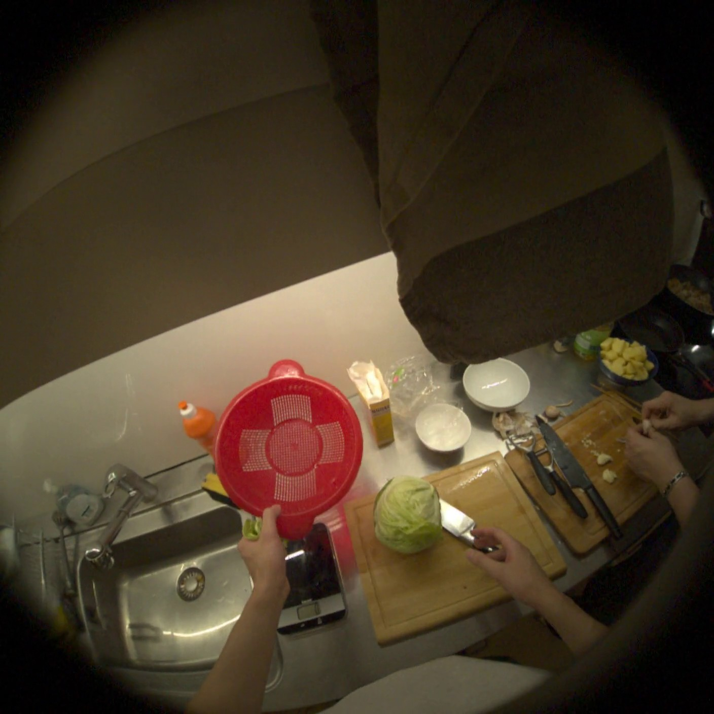
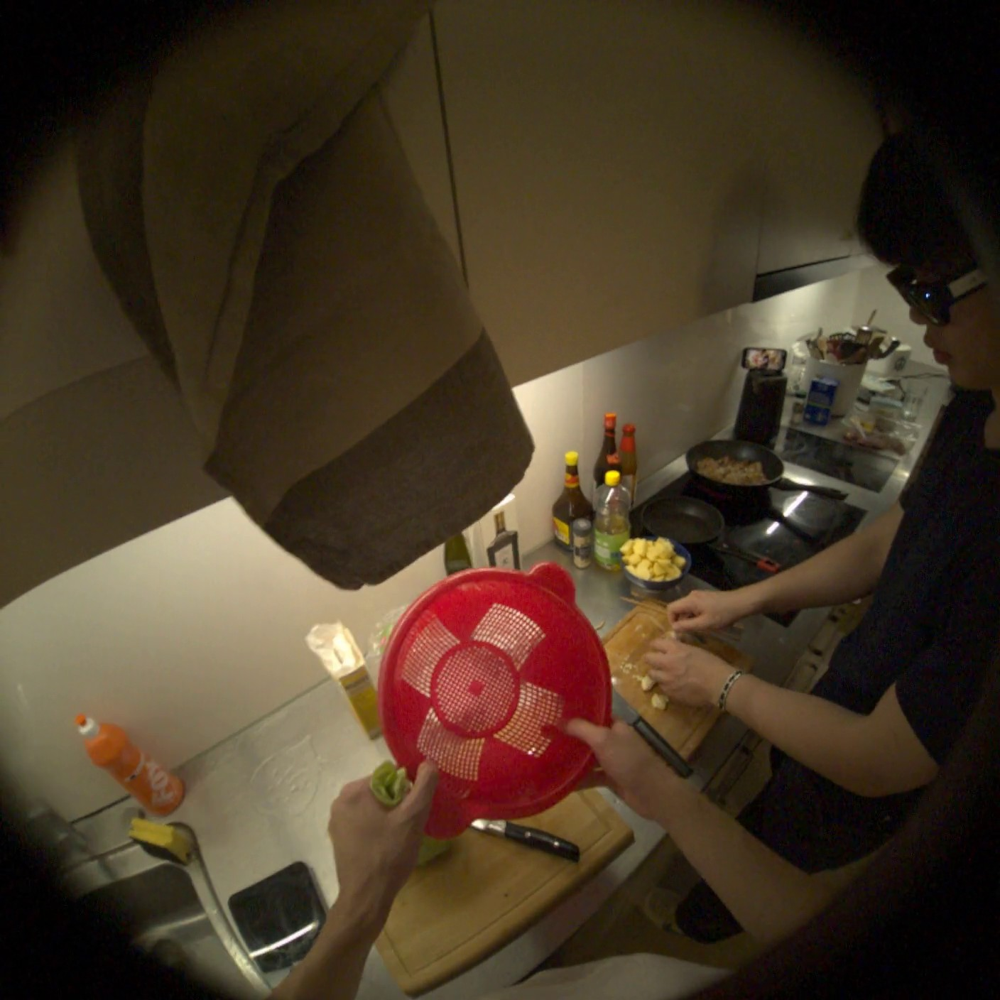
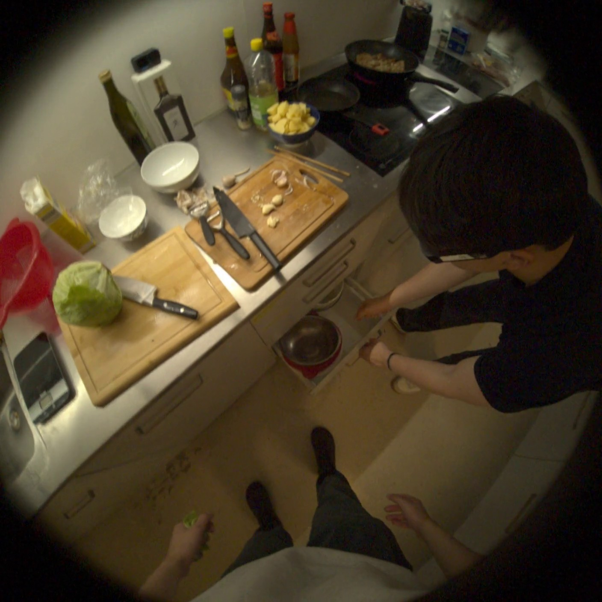

# CoMind 配对成功案例：SCOIA `032159`

这是冻结的 CoMind `gpt-5.6-sol` 300 例 paired 实验中的真实逐样本记录。Direct
和 Spatial-Social Code 使用完全相同的六张 helper 视角原帧及同一段转录；标签只在
生成结束后用于评分和选择展示案例。

## 样本与题目

| 字段 | 值 |
|---|---|
| Task | `scoia` |
| Recording ID | `3ef7356e-3b75-4eab-add9-363b0cdc2b99` |
| Sample ID | `032159` |
| Prediction time | `1069.067 s`，约第 `32072` 帧 |
| 模型 | `gpt-5.6-sol` |
| 转录 | `do you need? I need another big bowl to put the garbage.` |

题目不是选择题，而是结构化预测：根据 prediction frame 之前的 helper 观察，预测
未来 10 秒内 helper 将互动的物体框 `[x,y,width,height]`、提示类型、动作动词和
一级物体类别。完整英文题面和六张输入帧顺序保存在
[`comind_scoia_032159_positive_flip.json`](cases/comind_scoia_032159_positive_flip.json)。

## Direct、SSC 与正确答案

| 字段 | Direct | Spatial-Social Code | 正确答案 | 评分变化 |
|---|---|---|---|---|
| bbox | `[650,700,195,150]` | `[665,719,208,172]` | `[650.88,756.35,226,183.81]` | IoU `0.346 → 0.568`，**错→对** |
| cue type | verbal + implicit | verbal + gestural | verbal + gestural | **错→对** |
| action verb | pick up | retrieve | receive | 错→错 |
| action noun L1 | bowl | bowl | bowl | 对→对 |

因此这是两个正式字段上的 positive flip，且没有负翻转；它不是“四个字段全对”的
样本。300 例总体实验也没有显示 SSC 全面优于 Direct，本案例只用于解释 SSC 在
空间定位与社会提示组合上如何成功。

## 实际 Code

完整 Spatial Code 和 Social Code 与预测、标签、逐字段评分放在同一个案例 JSON
中。关键中间状态为：

- Spatial Code 将 `large_bowl` 定位到 `[665,719,208,172]`；
- Spatial Code 分别记录 verbal request 和 gestural drawer opening；
- Social Code 将“需要另一个大碗”的明确请求与打开抽屉的动作绑定，形成
  `retrieve the large bowl` 的目标和意图；
- 最终 SSC 因而输出 verbal + gestural，并保留该物体框。

这解释了两项正翻转与 Code 的直接联系；同时 `retrieve` 没有匹配标注动词
`receive`，说明语义近似并不会被 exact-match 指标自动判对。

## 对应原帧

下面均为推理时实际输入 JPEG 的逐字节副本，不是占位图或重建图。案例 JSON 保存
六张图的时间戳、约 30 fps 帧号和 SHA-256。

### 1065.067 s / 约第 31952 帧

### 1067.067 s / 约第 32012 帧

### 1069.067 s / 约第 32072 帧（prediction frame）

其余三张较早上下文帧：

- [第 31772 帧](cases/comind_scoia_032159_helper_f031772_context.jpg)
- [第 31832 帧](cases/comind_scoia_032159_helper_f031832_context.jpg)
- [第 31892 帧](cases/comind_scoia_032159_helper_f031892_context.jpg)

## 边界

该样本来自带标签的 CoMind train 子集，不是官方 hidden test。它是在全部预测完成
后按保存标签筛出的解释性案例，不能单独证明总体提升；总体结果应继续引用 300 例
paired 汇总。
