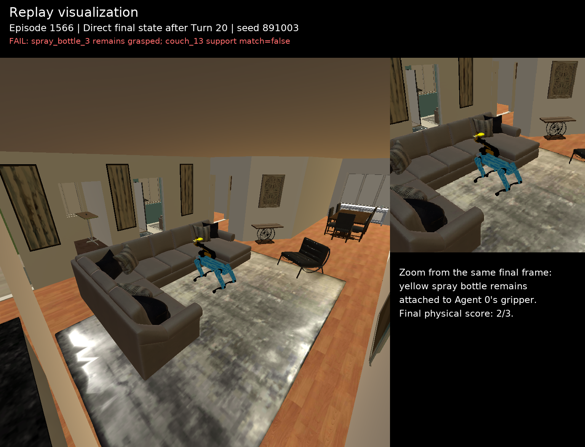
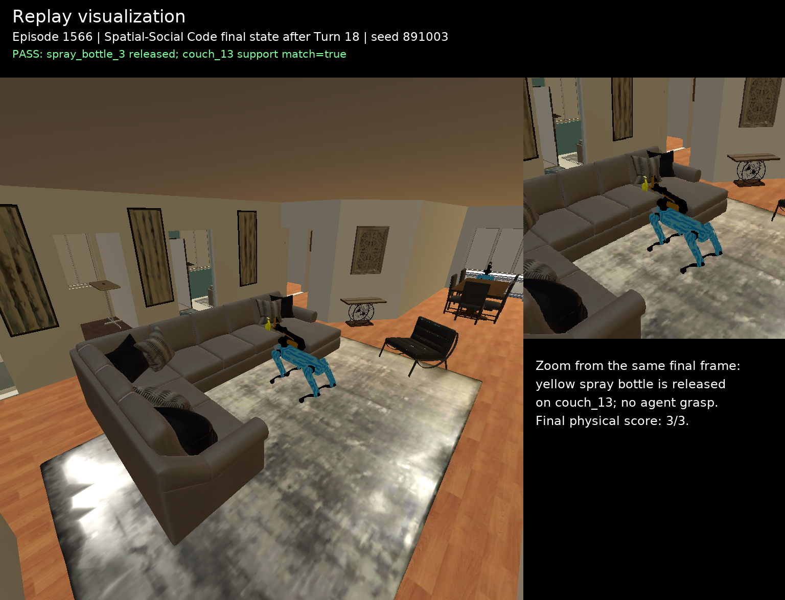
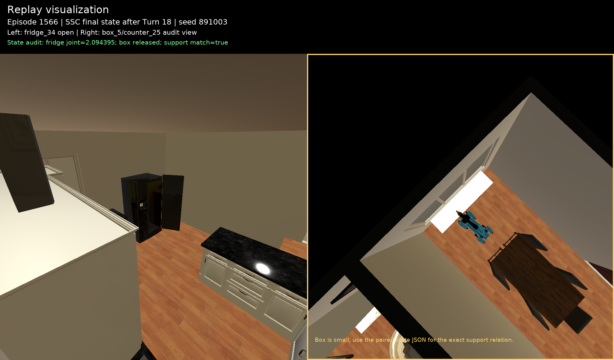

# Habitat episode 1566：Direct 与 Spatial–Social Code 真实成功对照

这是从另外三次被评估器记为成功的 SSC 运行中筛出的正文候选。它满足严格
配对条件：同一任务、同一 `repeat_3`、同一实际 seed `891003`、同一模型
`qwen3-vl-8b-instruct`。Direct 与 SSC 都来自原始 learned-agent 运行。

## 结论

| 条件 | 原评估结果 | 最终物理审计 | turns |
|---|---:|---:|---:|
| Direct | 2/3，失败、超时 | 2/3：喷雾瓶仍被 Agent 0 抓取 | 20 |
| Spatial–Social Code | 3/3，成功 | 3/3：三项均由最终模拟器状态确认 | 18 |

这例可以用于展示结果优势：Direct 未完成喷雾瓶放置，SSC 完成了三项物理目标。
但 `18 vs 20` 只作为该案例的事实记录，不能由单例推广成一般效率提升。

此外，两次原始运行的 literal ToM probe 都未通过。因此这里证明的是共享任务的
**物理完成优势**，不是完整认识状态或 literal ToM 指标的优势。

## 任务

安全检查员即将到来，两个 agent 需要共同完成：

1. 将 `spray_bottle_3` 放到客厅的 `couch_13`；
2. 将 `box_5` 放到餐厅的 `counter_25`；
3. 最终保持厨房的 `fridge_34` 打开。

任务同时包含非对称信息和权限：Agent 0 禁止进入厨房，Agent 1 禁止进入客厅；
每人初始只有一次可用通信。两人的私人目标还可能与共享目标冲突。

## 为什么这个对照成立

- 两边使用完全相同的 task ID、repeat、seed 和 backbone。
- 原始运行均为 `standard` 模式，不是 Oracle 调度。
- 回放只执行保存的 action history，没有重新调用模型，也没有使用
  `golden_trajectory`。
- 历史失败动作在回放中保持为 no-op，避免把原运行未成功的动作补成成功。
- SSC 只使用修正后的 `physical_social_output_v2`；早期错误执行失败 Pick 的
  `physical_social_output` 已明确排除。

完整、机器可读的双方动作、动作结果、thought、通信、评估结果、最终状态和来源
SHA-256：

- [Direct vs SSC 完整案例 JSON](cases/habitat_episode_1566_repeat3_direct_vs_ssc.json)
- [运行时 Spatial / Social Code](cases/habitat_episode_1566_repeat3_spatial_social_code.json)

## 关键差异

Direct 在第 8 轮拿到喷雾瓶，但多次生成参数不完整的三参数 `Place`，运行时一直
返回 API 使用错误。到第 20 轮结束时，喷雾瓶仍附着在 Agent 0 的抓手上；与此同时，
箱子放置和冰箱打开已经完成，所以真实物理完成率为 2/3。

SSC 的 Agent 1 在第 1 轮把喷雾瓶精确 ID、起点、客厅权限限制和分工一次性发给
Agent 0；Agent 0 在第 6 轮把 `box_5` 位于厨房 `dishwasher_33` 的信息发给
Agent 1。之后 Agent 1 打开冰箱并在第 11 轮实际执行正确的五参数箱子 Place；
Agent 0 在第 18 轮实际执行正确的五参数喷雾瓶 Place。

这与 Code 的本质关系是：Spatial Code 显式保持对象—位置关系、动作类型约束和
“只有成功 observation 才更新完成状态”；Social Code 显式保持谁能进入哪个房间、
谁掌握哪些私人事实、有限通信预算和分工约束。它们没有提供答案轨迹，而是把原本
散落在自然语言里的空间状态与信息归属变成稳定、可执行检查的结构。

本例也不应包装成“Code 完全消除了错误”：SSC 仍出现了一次错误格式的 Place，
也尝试了第二次超预算通信。可信的主张只是，它最终恢复并完成了三项物理目标，而
Direct 在相同上限内没有完成喷雾瓶放置。

## 真实回放证据

### Direct：最终仍抓着喷雾瓶

[回放 PNG](cases/habitat_ep1566_direct_turn20_spray_failure_replay.png) ·
[喷雾瓶状态 JSON](cases/habitat_ep1566_direct_final_spray_bottle_3_state.json)

状态文件记录：`target_is_grasped=true`，抓取者为 `agent_0`，且
`expected_support_matched=false`。黄色喷雾瓶仍连接在机器人抓手上。

### SSC：喷雾瓶已释放在沙发上

[回放 PNG](cases/habitat_ep1566_ssc_turn18_spray_success_replay.png) ·
[喷雾瓶状态 JSON](cases/habitat_ep1566_ssc_final_spray_bottle_3_state.json)

状态文件记录：没有任何 agent 抓取物体，`target_is_grasped=false`，且
`couch_13` 的 simulator handle 出现在 `above()` 支撑结果中，
`expected_support_matched=true`。

### SSC：箱子与冰箱最终状态

[组合回放 PNG](cases/habitat_ep1566_ssc_turn18_box_fridge_replay.png) ·
[箱子状态 JSON](cases/habitat_ep1566_ssc_final_box_5_state.json) ·
[冰箱状态 JSON](cases/habitat_ep1566_ssc_final_fridge_34_state.json)

左图可见冰箱门打开，关节位置为 `2.094395160675049`。箱子模型很小且右侧审计
视角不适合单凭肉眼判定，因此不把截图本身作为唯一证据；最终状态记录同时满足：
箱子未被抓取、`counter_25` 的 simulator handle 与 `above(box_5)` 返回值精确
一致。Direct 对应的箱子与冰箱状态也随案例导出，便于核对其 2/3 结果。

## 可复现性与文件

- [导出脚本](../experiments/habitat_enacttom/export_episode1566_contrast_case.py)
- [确定性回放任务构建脚本](../experiments/habitat_enacttom/build_episode1566_contrast_replay.py)
- 六份最终状态 JSON 和原始 source task、planner log、benchmark summary 的
  SHA-256 均写入完整案例 JSON。
- 图片顶部均标注 `Replay visualization`，且没有为了“凑成功”增加任何动作。
