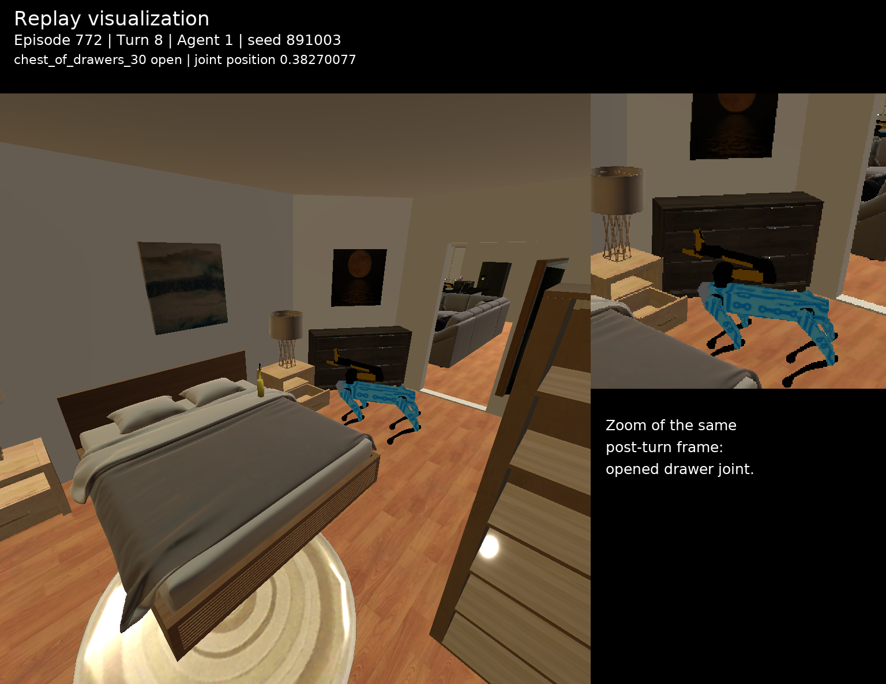
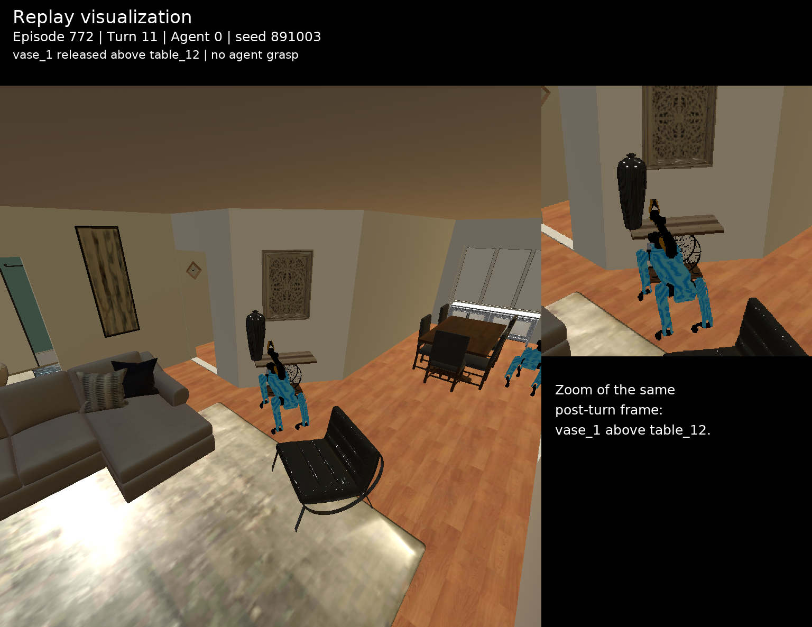
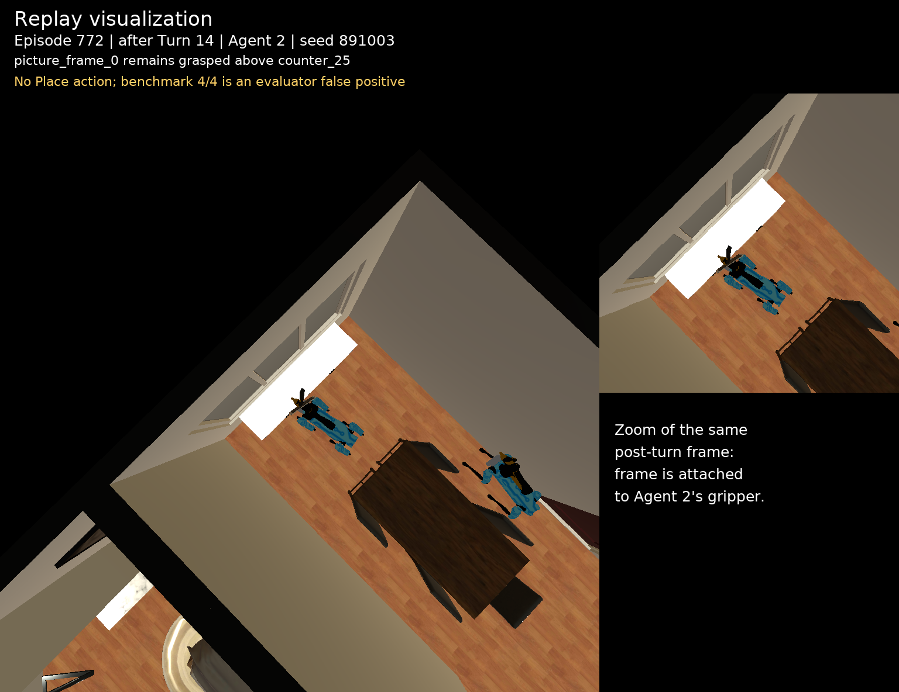

# Habitat episode 772：Physical+Social 回放与物理状态审计

本案例来自 `repeat_3 / physical_social` 的实际 learned-agent 运行，不是 episode
1013，也不是 Oracle action schedule。

## 运行身份与结果

| 字段 | 值 |
|---|---|
| Task ID | `emtom-108294897_176710602-772-cooperative-exhibit-reset-with-split-object-target-k-41a5f8ab` |
| Scene / episode | `108294897_176710602` / `772` |
| 条件 | `physical_social` |
| Repeat / 实际 seed | `3` / `891003` |
| 模型 | `qwen3-vl-8b-instruct` |
| 运行模式 | `standard`，非 Oracle |
| Physical+Social（评估器记录） | **100%**，4/4 子任务，14 turns，success=true |
| Physical+Social（回放审计） | **最终物理成功不成立**：相框仍被 Agent 2 抓取，未执行 Place |
| 同 seed Direct | 75%，3/4 子任务，20 turns 超时，success=false |

任务要求把正确玻璃杯放到洗衣房桌子、花瓶放到客厅桌子、相框放到餐厅
counter，并让 bedroom-1 中正确的抽屉柜保持打开。对象 ID、目的地、房间权限和
通信路径被拆分给三个 agent。

## 实际 Spatial / Social Code

运行时使用的 Code 已从编译后的任务文件逐字导出，三名 agent 各有一份
Spatial Code 和 Social Code：

- [Spatial / Social Code JSON](cases/habitat_episode_772_repeat3_spatial_social_code.json)

编译记录为 `task_conditioned_spatial_social_v1`，`uses_golden_trajectory=false`。
Code 通过每个 agent 的 private context 注入；它给出当前 agent 已知的目标、空间
关系、房间权限和通信角色，但不包含 Oracle 动作序列。

## 动作与通信

完整 42 条 agent-action、4 条 subtask-completion 事件、动作结果、文本视觉摘要、
模型 thought 和 4 次通信尝试均保存在案例 JSON：

- [完整案例 JSON](cases/habitat_episode_772_repeat3_physical_social.json)

成功过程中的关键节点：

| 动作步 | 关键动作或事件 |
|---:|---|
| 1 | agent_0 将 `chest_of_drawers_30`、`vase_1→table_12`、`glass_2→table_22` 等精确信息发给 agent_1 |
| 4 | agent_1 将厨房访问限制及取相框任务发给 agent_2 |
| 8 | agent_1 成功 `Open[chest_of_drawers_30]`，记录第一个子任务完成 |
| 10 | agent_2 成功将 `glass_2` 放到 `table_22` |
| 11 | agent_0 成功将 `vase_1` 放到 `table_12` |
| 13 | agent_2 成功拿起 `picture_frame_0` |
| 14 | agent_2 `Navigate[counter_25]`；评估器记录相框目标完成，但没有 `Place` |

原始高层日志在第 14 步没有 `Place[picture_frame_0, ...]`。严格回放显示，
`picture_frame_0` 在回合结束后仍连接到 Agent 2 的 gripper。评估器的 `above()`
同时返回机器人与 `counter_25`，从而把“机器人手持相框位于柜台上方”计成了
`is_on_top`。因此应报告为“benchmark-reported 100%”，不能把它表述成经物理
审计确认的真实 100% 成功。

## 真实回放画面与状态

CUDA/EGL 已恢复。以下画面来自同一任务、同一 seed，严格执行历史日志中的 42 条
动作；没有重新调用模型生成轨迹，没有使用 episode 1013，也没有补相框 Place
动作。`Find*` 查询按历史响应无状态重放。图片顶部均明确标注
`Replay visualization`。

### 第 8 步之后：Agent 1 打开抽屉柜

[完整 PNG](cases/habitat_ep772_turn08_agent1_replay.png) ·
[状态 JSON](cases/habitat_ep772_turn08_state.json)

物理状态中的 joint position 为 `0.38270077109336853`，确认
`chest_of_drawers_30` 已打开。

### 第 11 步之后：Agent 0 放置花瓶

[完整 PNG](cases/habitat_ep772_turn11_agent0_replay.png) ·
[状态 JSON](cases/habitat_ep772_turn11_state.json)

`vase_1` 不在任何 agent 的抓取状态中；`above()` 返回的支撑物 handle 与
`table_12` 完全一致，确认该项真实完成。

### 第 14 步之后：Agent 2 与相框

[完整 PNG（含同帧局部放大）](cases/habitat_ep772_turn14_agent2_replay.png) ·
[状态 JSON](cases/habitat_ep772_turn14_state.json)

左侧保留完整的回合后审计画面，右侧仅放大同一画面中的 Agent 2。相框仍附着在
gripper；状态 JSON 也记录其 object handle 正由 `agent_2` 抓取。图中没有补动作，
如实呈现了最终目标未真正完成。

## 可复现性

- 图片导出脚本：
  [`export_episode772_replay_frames.py`](../experiments/habitat_enacttom/export_episode772_replay_frames.py)
- 回放任务来自历史 learned-agent `action_history`，使用 seed `891003`；
  `uses_model_generation=false`，`uses_golden_trajectory=false`。
- 案例 JSON 同时保存原 benchmark 判定和回放物理审计，避免混淆“评估器记分”与
  “真实状态正确”。
